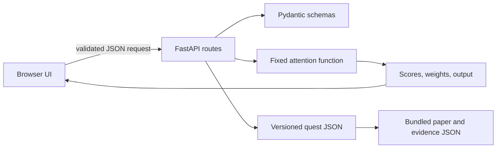
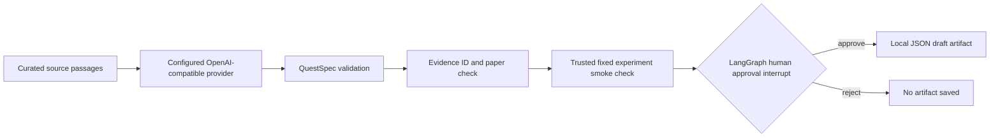

# Architecture and trust boundaries

## Learner request path

The public runtime has no LLM dependency and does not persist visitor data. `/health` reports process health; `/ready` validates that bundled content can load.

## Local authoring path

The model can draft data only. The authoring code does not accept model-generated functions or execute code. An approved artifact is not automatically added to the public quest route; a person must review it and change the curated content deliberately. The local CLI currently uses an in-memory LangGraph checkpointer, so an interrupted review is resumable only while that process remains alive.

## Components

- `src/paperquest/main.py`: FastAPI app, health/readiness, validated experiment, comparison, and quiz endpoints; static app serving.
- `src/paperquest/attention.py`: deterministic scaled dot-product attention using fixed teaching vectors.
- `src/paperquest/specs.py`: strict versioned schemas and cross-reference checks.
- `src/paperquest/resources/data/`: bundled paper/evidence and quest metadata.
- `src/paperquest/web/`: accessible HTML/CSS/JavaScript learner experience.
- `src/paperquest/authoring.py`: optional local LangGraph draft-and-review workflow.
- `tests/`, `scripts/evaluate.py`: API, content, workflow, and numeric-invariant checks.

## Operational boundaries

The rate limit and its counters are in process memory. They reset on restart and do not coordinate across workers; place a shared gateway/proxy in front of a multi-instance deployment. Request body size is checked using `Content-Length`; an ingress proxy should enforce its own hard body limit too. No secrets are required for the learner app. The optional authoring secret must stay in the local process environment or a deployment secret manager if the private workflow is ever hosted.
